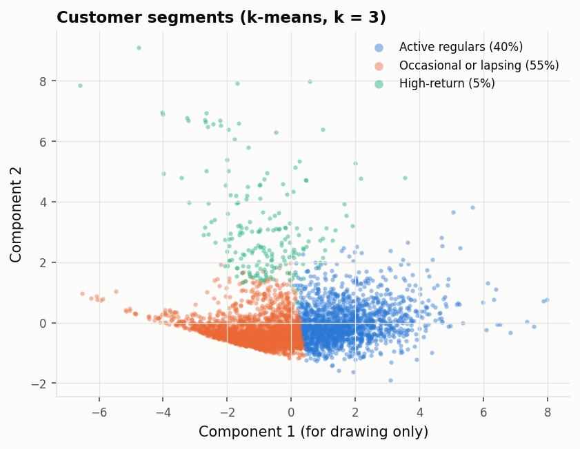
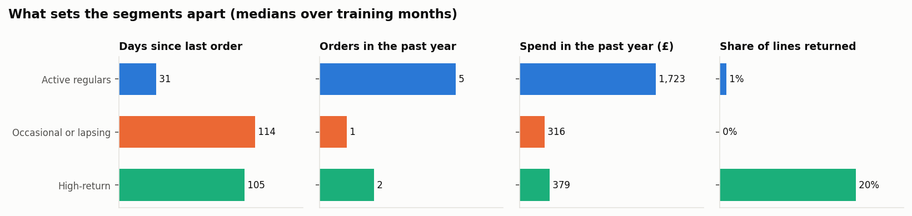
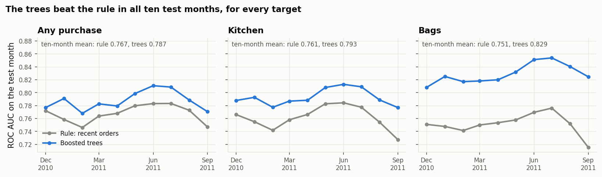
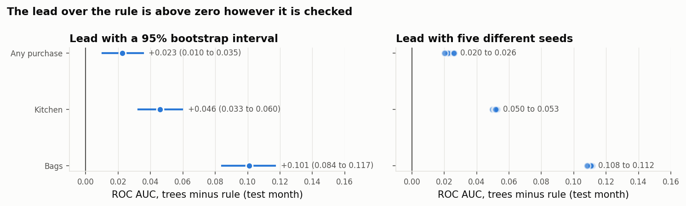

# online-retail-purchase-prediction

Customer segmentation and purchase prediction on Databricks, using two years of real
transactions from a UK online gift shop (Online Retail II, UCI): about a million rows and
5,875 customers after cleaning.

The models rank customers by how likely they are to buy again in the next 90 days, overall
and per product category (kitchen, bags), and estimate how many will.

## Key findings

- **Boosted trees beat a simple order-count rule in all ten test months**, for every target.
  The gain is largest for bags: ROC AUC 0.83 against 0.75, average precision 0.64 against
  0.48. For any purchase the gain is small.
- **The gain comes from category history**, which the order-count rule doesn't see.
- **The model adds most where history is thinnest.** For customers with a single order in
  the past year, the rule barely ranks anyone (ROC AUC 0.55); the trees' lead there is 1.5
  to 1.9 times larger than overall.
- **The probabilities are calibrated** (expected calibration error below 0.05), so the
  scores also estimate how many customers will buy.
- **Stable and cheap to retrain.** Five random seeds moved ROC AUC by at most 0.006, and
  one month of training data scored the same as seventeen.
- **Three customer segments:** active regulars (40%), occasional or lapsing buyers (55%)
  and a small high-return group (5%). They describe customers well but did not improve
  the predictions.

Detailed tables are in [docs/results.md](docs/results.md).

## Figures



The segments drawn on two principal components, for display only; k-means used all six
segmentation features.







## How it was evaluated

- **Point-in-time features.** Each monthly snapshot uses only the year before the cutoff
  for features and the 90 days after it for labels. Tests check the boundary.
- **Out-of-time validation.** Train on earlier months, choose and calibrate on the next,
  report on the month after, repeated over ten test months.
- **A baseline first.** Every model is compared with ranking customers by recent orders.
- **Ranking and calibration** are both measured: ROC AUC, average precision and top-decile
  lift for who to contact; calibration error for how many will buy.
- **Predictions written down first.** Before each round of further checks, the expected
  outcomes were committed. Three of seven held in round three and six of eight in round
  four, and all are reported.

## What did not help

- **Extra features** (seasonality, regularity, trend, category recency) changed the trees'
  ROC AUC by at most 0.003; the base features already carried the information.
- **Segments** changed no model by more than 0.007 ROC AUC, as they are built from the same
  features. Within segments, the model is weakest for occasional buyers (ROC AUC 0.64).

## Limitations

- All test months fall within one year, with one Christmas season.
- Product categories come from keyword rules; 28% of spend is "other".
- Customers without an id (23% of rows) are left out.

## Pipeline

| Notebook | What it does |
|---|---|
| `01_ingest` | Downloads the data and cleans it into Delta tables in Unity Catalog |
| `02_snapshots` | One row per customer per monthly cutoff: features before, labels after |
| `03_segments` | Compares k-means and a Gaussian mixture, fits the chosen segmentation |
| `04_propensity` | Trains and compares the models per target, logs them to MLflow, registers the best |
| `05_recommend` | Next-best category per customer, against simple baselines |
| `06_score` | Scores new months with the registered models and checks drift (PSI) |
| `07_figures` | Draws the figures above |

The logic lives in `src/custprop` and is unit-tested outside Databricks; the notebooks load
data, call it and log results. `databricks.yml` defines the pipeline as one job.

## Running it

On Databricks: create a Git folder from this repository and run the notebooks in order, or
deploy the job with `databricks bundle deploy` (set your workspace URL in `databricks.yml`
first). Tables are written to `workspace.custprop`.

Tests run the Spark code on a small synthetic dataset with local Spark (Java 17 needed):

```bash
pip install -e ".[dev]"
pytest
```
