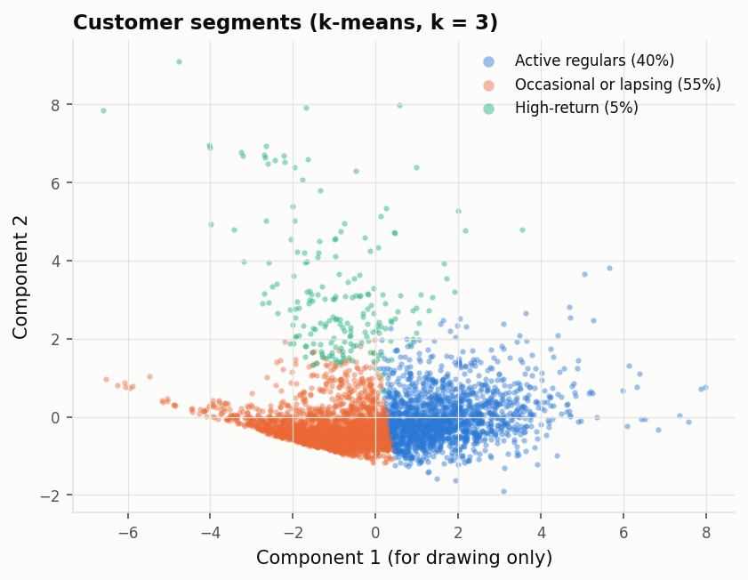
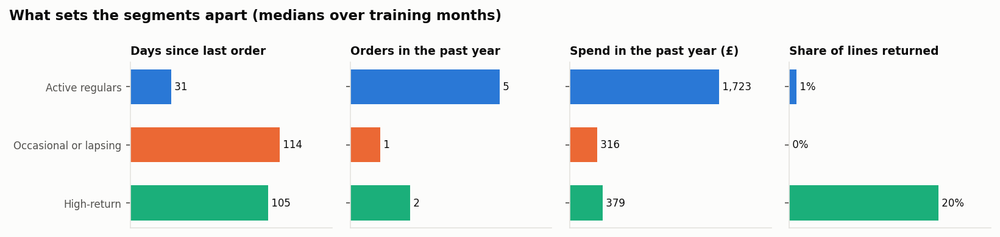
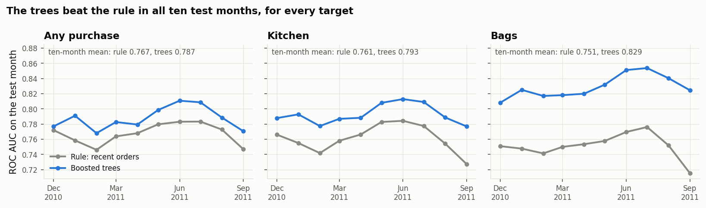
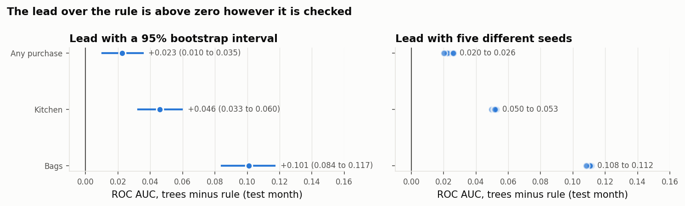

# Detailed results

All numbers come from the pipeline on Databricks Free Edition (serverless), on the full
Online Retail II dataset. The models train on monthly cutoffs up to July 2011, are
calibrated and chosen on August 2011, and are tested on September 2011, unless a section
says otherwise. ROC AUC and average precision measure ranking; the calibration error is the
expected calibration error over ten equal-sized bins.

## Data

| | |
|---|---|
| Raw rows (both yearly sheets) | 1,067,371 |
| No customer id | 243,007 |
| Zero or negative price | 6,207 |
| Non-product codes | 5,931 |
| Clean rows (returns included) | 794,165 (17,586 returns) |
| Customers | 5,875 |

The dropped counts overlap, and exact duplicates are removed as well. About 23% of rows
have no customer id. They can't be followed over time, so all results are about customers
who ordered while logged in. The keyword categories cover 72% of spend.

19 monthly snapshots (March 2010 to September 2011) have 1,700 to 4,300 active customers
each. Apart from the earliest months, the share who buy again within 90 days is highest for
the September cutoffs (0.58 in 2010, 0.50 in 2011) and lowest after Christmas (0.33).

## Segments

k-means with k from 2 to 8 and a Gaussian mixture were compared on the training months.
k-means with k = 3 had the highest silhouette of all 14 options (0.32, against 0.23 for
k = 4). Two random seeds gave the same segments (adjusted Rand index 1.00), and no segment
was under 5%. The Gaussian mixture separated less well at every k and was unstable at
k = 3. Its BIC kept improving as k grew, which says little with this many rows.

| Segment | Share | Last order | Orders / year | Spend / year | Returns |
|---|---|---|---|---|---|
| Active regulars | 40% | 31 days ago | 5 | £1,722 | 1% of lines |
| Occasional or lapsing | 55% | 114 days ago | 1 | £316 | 0% |
| High-return | 5% | 105 days ago | 2 | £379 | 20% of lines |

(shares and medians are over training snapshots, so a customer counts once per month they
appear in)

## Round 1: base features

| Target | Base rate | Model | ROC AUC | Avg. precision | Lift, top 10% | Calibration error (raw → isotonic) |
|---|---|---|---|---|---|---|
| any purchase | 0.50 | recent orders (no model) | 0.747 | 0.749 | 1.84 | (not a probability) → 0.073 |
| | | logistic regression | 0.764 | 0.782 | 1.91 | 0.070 → 0.065 |
| | | boosted trees | **0.772** | **0.792** | **1.93** | 0.057 → 0.042 |
| kitchen | 0.43 | recent orders | 0.727 | 0.671 | 1.94 | → 0.065 |
| | | logistic regression | 0.767 | 0.732 | 2.10 | 0.054 → 0.060 |
| | | boosted trees | **0.778** | **0.750** | **2.17** | 0.055 → 0.047 |
| bags | 0.28 | recent orders | 0.715 | 0.507 | 2.28 | → 0.047 |
| | | logistic regression | 0.806 | 0.660 | 2.86 | 0.034 → 0.041 |
| | | boosted trees | **0.827** | **0.702** | **3.03** | 0.041 → 0.024 |

Adding the segment as a feature changed nothing (any purchase: 0.771 against 0.772). One
model per segment looked best on the validation month (0.819) but was slightly worse on the
test month (0.768). Isotonic calibration lowered the trees' calibration error for all three
targets; for logistic regression it helped only for any purchase.

## Round 2: extended features

The extended features were chosen from what round 1 suggested was missing, before running
them: seasonality (orders and spend in the same 90-day window one year earlier), regularity
(mean and spread of the gaps between order days), trend (the 90 days before the last 90) and
category recency (days since the last purchase in each category).

| Target | Model | Base features: ROC AUC / avg. precision / calibration error | Extended features |
|---|---|---|---|
| any purchase | logistic regression | 0.764 / 0.782 / 0.070 | 0.767 / 0.785 / 0.065 |
| | boosted trees | 0.770 / 0.791 / 0.057 | 0.767 / 0.790 / 0.048 |
| kitchen | logistic regression | 0.767 / 0.732 / 0.054 | 0.769 / 0.737 / 0.050 |
| | boosted trees | 0.778 / 0.751 / 0.044 | 0.778 / 0.751 / 0.034 |
| bags | logistic regression | 0.806 / 0.660 / 0.034 | 0.814 / 0.676 / 0.033 |
| | boosted trees | 0.826 / 0.699 / 0.037 | 0.825 / 0.702 / 0.022 |

(calibration error before isotonic calibration)

### Rolling evaluation

Each of June, July, August and September 2011 as the test month. ROC AUC, mean and range:

| Target | Recent orders (no model) | Boosted trees, base | Boosted trees, extended |
|---|---|---|---|
| any purchase | 0.771 (0.747 to 0.783) | 0.794 (0.770 to 0.807) | 0.794 (0.767 to 0.810) |
| kitchen | 0.761 (0.727 to 0.784) | 0.796 (0.778 to 0.810) | 0.797 (0.778 to 0.812) |
| bags | 0.753 (0.715 to 0.776) | 0.842 (0.826 to 0.852) | 0.842 (0.825 to 0.856) |

Average precision for bags, mean over the four months: 0.504 for the baseline, 0.689 for
the trees.

### Within each segment

| Segment | Customers | Bought again (any) | ROC AUC: any / kitchen / bags |
|---|---|---|---|
| Active regulars | 1,683 | 0.75 | 0.75 / 0.75 / 0.81 |
| Occasional or lapsing | 2,462 | 0.34 | 0.64 / 0.65 / 0.73 |
| High-return | 179 | 0.32 | 0.67 / 0.73 / 0.80 |

## Round 3: predictions written before the run

These predictions were committed (cae372a) before the checks were run, and are copied here
unchanged.

1. **Learning curve.** For every target, the trees trained on all training months score
   at least 0.01 ROC AUC higher than trees trained on the most recent month only. The gain
   from 8 months to all months is smaller than the gain from 1 month to 2.
2. **Feature group importance** (extended trees, test month). For any purchase, the
   largest drop in ROC AUC comes from shuffling recency or frequency. For bags, category
   shares or category recency is among the two largest drops. If so, this supports the
   explanation for the bags result in the first version, which so far is only a likely
   reason.
3. **Segments in a linear model.** Adding the segment raises logistic regression's test ROC
   AUC for every target, and changes the base trees' ROC AUC by less than 0.005. A linear
   model can't find these groups itself, and the trees can.
4. **One-order customers.** On test-month customers with one order in the past year, the
   gap between the base trees and the order-count baseline is larger than on all customers,
   for every target. The extended features help these customers more than they help all
   customers, for at least two of the three targets.

| Prediction | Result | Verdict |
|---|---|---|
| 1. All training months beat the most recent month by at least 0.01 ROC AUC | One month scored the same as all 17: any purchase 0.777 against 0.772, kitchen 0.777 against 0.778, bags 0.822 against 0.827 | not supported |
| 2a. Recency or frequency matters most for any purchase | Regularity (drop 0.027), breadth (0.022) and spend (0.016) came first; recency and frequency each dropped it by about 0.003 | not supported |
| 2b. Category features are in the top two for bags | Category recency (0.063) and category shares (0.046) were the top two | supported |
| 3a. Segments raise logistic regression's ROC AUC | Unchanged to four decimals for all three targets | not supported |
| 3b. Segments change the base trees by less than 0.005 | Changes of 0.001 or less | supported |
| 4a. The trees lead the baseline by more on one-order customers | The lead grew 1.5 to 1.9 times: any purchase 0.046 against 0.025, kitchen 0.096 against 0.051, bags 0.164 against 0.112 | supported |
| 4b. The extended features help one-order customers more, for two of three targets | Only for bags (+0.005); any purchase −0.005, kitchen −0.015 | not supported |

(one-order customers: 1,578 of the 4,324 in the test month)

### Feature group importance

Drop in test ROC AUC when one group is shuffled, extended trees, mean of five shuffles (the
two largest per target in bold):

| Group | Any purchase | Kitchen | Bags |
|---|---|---|---|
| category recency | 0.008 | **0.051** | **0.063** |
| breadth (products, tenure) | **0.022** | **0.048** | 0.042 |
| category shares | 0.006 | 0.013 | **0.046** |
| regularity | **0.027** | 0.015 | 0.010 |
| spend | 0.016 | 0.008 | 0.005 |
| recency | 0.004 | 0.000 | 0.000 |
| frequency | 0.003 | 0.000 | 0.001 |
| trend, seasonality, returns, context | 0.002 or less each | 0.002 or less each | 0.001 or less each |

### Learning curve

ROC AUC of the base trees on the test month, by number of most recent training months:

| Training months | 1 | 2 | 4 | 8 | 17 (all) |
|---|---|---|---|---|---|
| Training rows | 4,314 | 8,638 | 17,275 | 34,200 | 59,979 |
| any purchase | 0.777 | 0.777 | 0.778 | 0.778 | 0.772 |
| kitchen | 0.777 | 0.780 | 0.777 | 0.779 | 0.778 |
| bags | 0.822 | 0.825 | 0.820 | 0.821 | 0.827 |

### One-order customers

ROC AUC on the 1,578 test-month customers with one order in the past year:

| Target | Recent orders (no model) | Boosted trees | Lead (all customers) |
|---|---|---|---|
| any purchase | 0.560 | 0.606 | 0.046 (0.025) |
| kitchen | 0.559 | 0.656 | 0.096 (0.051) |
| bags | 0.551 | 0.715 | 0.164 (0.112) |

## Round 4: longer window, seeds and tuning

The design and predictions are in [round4_predictions.md](round4_predictions.md), committed
(28ca6dc) before the run. The tables below come from that run; the raw tables are in
[round4/](round4/).

### Longer rolling evaluation

Each of the ten months from December 2010 to September 2011 as the test month, each trained
on all earlier months. ROC AUC, mean and range:

| Target | Recent orders (no model) | Boosted trees, base | Boosted trees, extended |
|---|---|---|---|
| any purchase | 0.767 (0.746 to 0.783) | 0.786 (0.771 to 0.808) | 0.787 (0.768 to 0.811) |
| kitchen | 0.761 (0.727 to 0.784) | 0.792 (0.776 to 0.812) | 0.793 (0.777 to 0.813) |
| bags | 0.751 (0.715 to 0.776) | 0.831 (0.813 to 0.853) | 0.829 (0.808 to 0.854) |

The extended trees beat the rule in all ten months for every target. Their lead over the rule,
mean and range: any purchase 0.020 (0.005 to 0.033), kitchen 0.032 (0.022 to 0.050), bags
0.078 (0.057 to 0.109). Average precision for bags, mean over the ten months: 0.475 for the
rule, 0.636 for the extended trees.

### Seeds

Base and extended trees refitted with seeds 7, 11, 23, 42 and 99 on the main split, test
month September 2011:

| Target | Model | ROC AUC, lowest to highest | Range | Lead over the rule |
|---|---|---|---|---|
| any purchase | base | 0.767 to 0.772 | 0.0043 | 0.020 to 0.025 |
| any purchase | extended | 0.767 to 0.773 | 0.0060 | 0.020 to 0.026 |
| kitchen | base | 0.777 to 0.779 | 0.0014 | 0.050 to 0.051 |
| kitchen | extended | 0.777 to 0.780 | 0.0030 | 0.050 to 0.053 |
| bags | base | 0.825 to 0.829 | 0.0033 | 0.110 to 0.114 |
| bags | extended | 0.823 to 0.827 | 0.0033 | 0.108 to 0.112 |

### Light tuning

Each model refitted with every candidate setting (20 shared tree settings, 7 values of C for
logistic regression); the setting with the best validation average precision was kept.

| Target | Model | Test ROC AUC, default | Tuned | Change |
|---|---|---|---|---|
| any purchase | logistic, base / extended | 0.764 / 0.767 | 0.764 / 0.767 | +0.001 / +0.001 |
| any purchase | trees, base / extended | 0.772 / 0.771 | 0.764 / 0.770 | −0.008 / −0.001 |
| kitchen | logistic, base / extended | 0.767 / 0.769 | 0.767 / 0.769 | 0.000 / 0.000 |
| kitchen | trees, base / extended | 0.778 / 0.777 | 0.778 / 0.773 | 0.000 / −0.004 |
| bags | logistic, base / extended | 0.806 / 0.814 | 0.806 / 0.814 | 0.000 / 0.000 |
| bags | trees, base / extended | 0.827 / 0.824 | 0.825 / 0.816 | −0.002 / −0.009 |

The same tree setting won on the validation month for all six tree models (learning rate
0.18, 63 leaves, minimum leaf size 50), and it scored slightly lower than the defaults on the
test month in all six. The tuned extended trees against the rule on the test month, with 95%
paired-bootstrap intervals: any purchase +0.023 (0.010 to 0.035), kitchen +0.046 (0.033 to
0.060), bags +0.101 (0.084 to 0.117).

### Predictions against results

| Prediction | Result | Verdict |
|---|---|---|
| 1.1 Extended trees beat the rule in all 10 months for bags and kitchen, at least 8 of 10 for any purchase | 10 of 10 for all three targets | supported |
| 1.2 The three lowest any-purchase months are among December, January and February | The lowest were February (0.768), September (0.770) and December (0.777); January was among the highest (0.791) | not supported |
| 1.3 The 10-month lead is at least half the June to September lead, for every target | 0.87 of it for every target (any 0.020 against 0.023, kitchen 0.032 against 0.036, bags 0.078 against 0.089) | supported |
| 2.1 Each tree model varies by less than 0.005 across seeds, for every target | 5 of 6 did; the extended trees for any purchase varied by 0.0060 | not supported |
| 2.2 The lead over the rule keeps its sign for every seed and target | Positive in all 30 runs, at least 0.020 | supported |
| 3.1 Tuned trees within 0.01 of the defaults, for every target | Largest change −0.0085 | supported |
| 3.2 A tree model still has the best validation average precision after tuning, for every target | Trees first for all three (any 0.820 against 0.767 for logistic regression, kitchen 0.776 against 0.713, bags 0.745 against 0.658) | supported |
| 3.3 The tuned extended trees' lead has an interval above zero for kitchen and bags | Kitchen 0.033 to 0.060, bags 0.084 to 0.117 (any purchase too: 0.010 to 0.035) | supported |

Six of eight predictions held.

### What it shows

- **The lead over the rule is not a summer effect.** Over ten months, including the
  Christmas season, the trees won every month for every target, and the average lead was
  0.87 of what the four summer months showed.
- **It is not one lucky seed.** Across five seeds the test ROC AUC moved by at most 0.006,
  much less than the lead over the rule (at least 0.020).
- **The default settings were already adequate.** Tuning on the validation month picked a
  faster, larger setting that did slightly worse on the test month, so the defaults stay.
  Choosing settings on a single month carries its own risk of fitting that month.
- **Prediction 1.2 was wrong about which months are hard.** The September cutoff, whose
  90-day window runs into the run-up to Christmas, was one of the hardest for any purchase,
  and its share of customers buying was the highest of the ten (50%). A plausible reading
  is that seasonal buying brings back customers whose history gives little sign of it; this
  is not separately tested.

## Reproducibility

Spark returns rows in no fixed order, so the trees came out slightly different on a rerun
(ROC AUC 0.770 against 0.772 for any purchase), and k-means could give the same segments
different numbers. Since round 2 the notebooks sort rows before modelling, and segments are
numbered by recency, most recent first.
